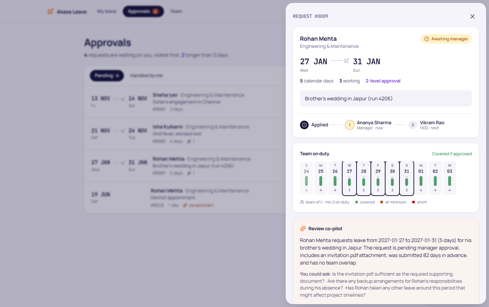
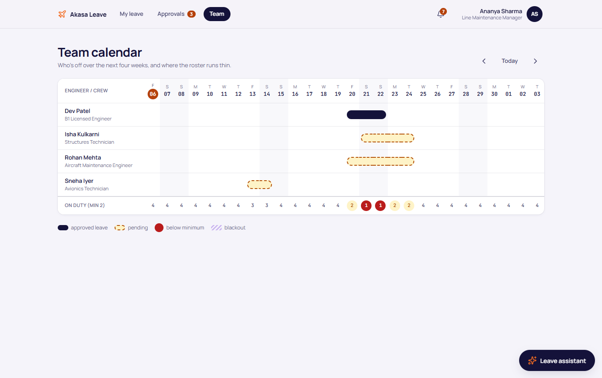
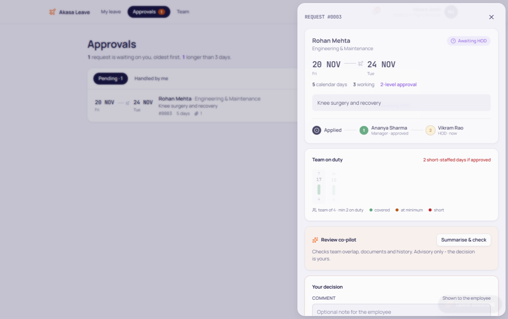
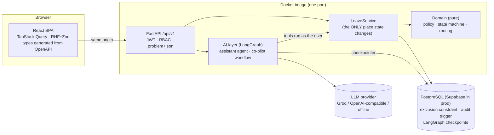
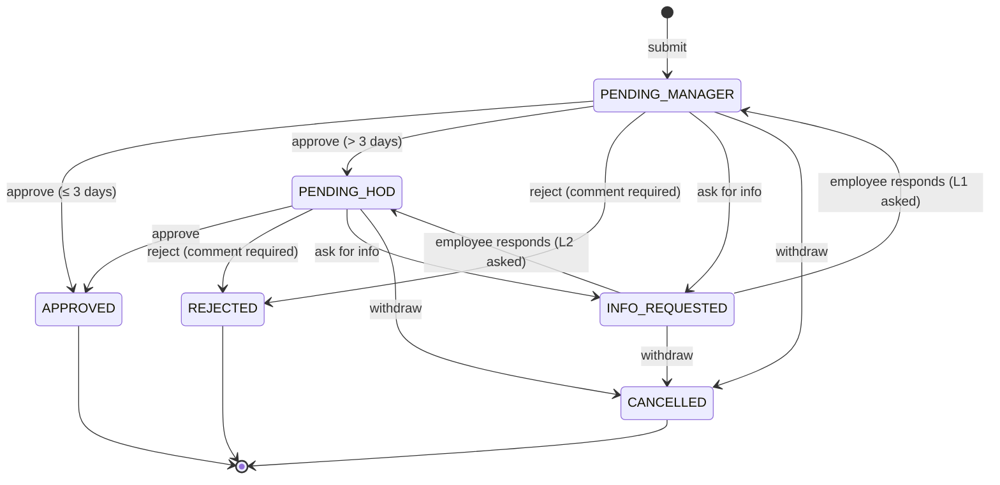
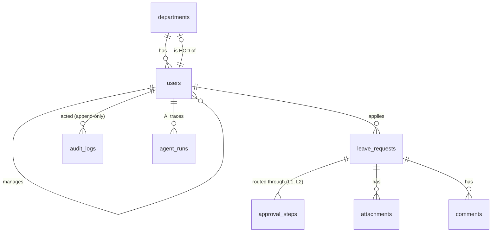
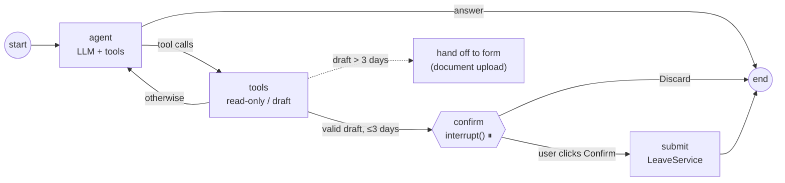

# Akasa Leave: Employee Leave Management

[](https://github.com/Achindra2003/akasa-leave-management/actions/workflows/ci.yml)
    

A leave portal where employees apply, managers and HODs approve, and every step is audited. It also includes an AI assistant that drafts leave from plain English and never submits anything without the employee's confirmation.

> **Why this matters at an airline:** crew and engineer leave is *operational capacity*, not just an HR record. A cabin crew member's leave changes the roster, and an engineer's leave can collide with a scheduled C-check. So approvers see who else on the team is off before they decide, and nothing is approved without a clear, auditable sign-off chain.

<p align="center"></p>

---

## Run it (one command)

```bash
docker compose up --build
```
Open **http://localhost:8000** and click any demo account. No setup, keys or seed scripts are needed.

| Account | Role | Try this |
|---|---|---|
| **Rohan Mehta** | Employee | Apply for 5 days → the form asks for a document → submit |
| **Ananya Sharma** | Manager (L1) | Approve Rohan's request → it moves to the HOD |
| **Vikram Rao** | HOD (L2) | Give the second sign-off for leave longer than 3 days |
| **Meera Joshi** | HOD + delegate | Vikram is on leave today, so his queue appears here. Open Rohan's request to see the document checks and coverage |
| **Priya Nair** | HR admin | Org overview, all requests, audit log, **blackout periods** |
| **Kabir Singh** | Employee (edge case) | His manager *is* his HOD, so level 2 routes to HR. His certificate is a **reused file**, and verification flags it |

All demo passwords are `Akasa@2026`. API docs (Swagger) are at **http://localhost:8000/api/docs**.

**AI is optional.** Without a key, the assistant runs on a deterministic offline model, so the whole flow is demoable. To use a real LLM, copy `.env.example` to `.env`, set `LLM_API_KEY` (Groq by default; any OpenAI-compatible provider works), and run `docker compose up` again.

<details><summary>Run without Docker (dev mode)</summary>

```bash
docker compose up -d db                      # Postgres only
cd backend && uv sync && uv run alembic upgrade head && uv run python run_dev.py   # :8000
cd frontend && npm ci && npm run dev         # :5173 (proxies /api to :8000)
```
</details>

---

## What it does

**Brief requirements → where they live**

| Requirement | Implementation |
|---|---|
| Submit / view / status of requests | Apply form + "My leave history" with status filters ([`MyLeaves.tsx`](frontend/src/pages/MyLeaves.tsx)) |
| Managers: view pending, approve, reject, comment | Approvals queue + request sheet; a comment is **required** to reject ([`RequestSheet.tsx`](frontend/src/components/RequestSheet.tsx)) |
| **> 3 consecutive days → documents + Manager → HOD** | Enforced server-side in [`policy.py`](backend/app/domain/policy.py) and [`workflow.py`](backend/app/domain/workflow.py); the UI shows the upload area as soon as the range exceeds 3 days |
| Attach / view documents | PDF/PNG/JPG ≤ 5 MB, served only to people in the approval chain, and every view is audited |
| Ask for more information | `INFO_REQUESTED` state; the employee responds (and can add documents) and the request **returns to whoever asked** |
| Leave fields (`employeeName`, `fromDate`, `toDate`, `reason`) | Same camelCase contract on the wire ([`schemas.py`](backend/app/schemas.py)) |
| ➕ Audit logs | Append-only `audit_logs` table (**a DB trigger blocks UPDATE/DELETE**), per-request timeline, HR audit view |
| ➕ Friendly errors | RFC 9457 `problem+json` with per-field messages written for people, shown verbatim in the UI |
| ➕ Colour coding | Each status has a colour **plus an icon and a label** (never colour alone) |
| ➕ Responsive | Mobile-first layouts, 16px inputs (no iOS zoom), safe-area aware ([mobile screenshot](docs/screenshots/07-mobile.png)) |

**Beyond the brief**
- **AI leave assistant (LangGraph agent).** "Next Monday for 3 days for my cousin's wedding" becomes a validated draft, and the employee then clicks **Confirm**. The graph *pauses* on a checkpointed `interrupt()` until they do.
- **Approver co-pilot (LangGraph workflow).** It summarises a request and flags teammates off on the same dates, missing documents, short notice and frequent requests. It is advisory only.
- **Real-org routing.** No self-approval. Manager = HOD → level 2 goes to HR. An HOD applying → their manager, then HR. No manager → HR. ([D-001](docs/DECISIONS.md))
- **Correct under concurrency.** A Postgres **exclusion constraint** makes overlapping leave impossible even with simultaneous submits, and **optimistic locking** stops two approvers acting on the same request at once.

---

## Operational extras (what a real airline HR desk needs)

| Feature | What it does | Why it matters |
|---|---|---|
| **Document verification** ([D-018](docs/DECISIONS.md)) | Every upload is fingerprinted (SHA-256) and pre-checked: **the same file reused on another request**, PDF made in an image editor, and an AI/heuristic read of name, dates and document type **cross-checked against the request**. An approver then clicks **Verify** or **Flag** | "Documents required" becomes an actual control. The AI advises; a human decides, and every decision is audited |
| **Team coverage** ([D-021](docs/DECISIONS.md)) | Live "team on duty" strip **while applying**, with one-tap fully-covered alternative dates; "if approved" view for approvers; a manager **team calendar** | Conflicts surface before anyone submits, not in a rejection days later. Staffing is the airline's product |
| **Blackout periods** ([D-019](docs/DECISIONS.md)) | HR defines windows (C-check, peak travel); any overlapping leave also goes to the HOD | Escalates instead of blocking outright, because emergencies still happen |
| **Delegation** ([D-020](docs/DECISIONS.md)) | Approvers name a delegate who acts **only while they're on approved leave**; the step records who really decided | A manager's holiday doesn't stall the whole team's requests |
| **Notifications** ([D-022](docs/DECISIONS.md)) | Bell with per-event messages, written in the same transaction as the change | Closes the loop; the same table is the outbox for future email/Slack |

<p align="center">
  
  
</p>

---

## Architecture



Business rules live in a **pure domain layer** with no framework or I/O, which is unit-tested in milliseconds. The REST API **and** the AI assistant both go through the same `LeaveService`, so an AI-initiated request gets exactly the same validation, routing, RBAC and audit as one from the form.

### Request lifecycle


The whole lifecycle is **one transition table** ([`workflow.py`](backend/app/domain/workflow.py)). Any other move returns `409` with a human-readable reason. The API also returns `allowedActions` *for the current viewer*, so the UI only ever renders buttons that will work.

### Data model


Approval steps are **rows, not columns**, so adding a third level (e.g. Ops control for crew) needs no schema change.

### The AI assistant (LangGraph)


- **Least privilege.** The model's tools are `get_leave_policy`, `list_my_requests` and `draft_leave_request`. There is **no submit, approve or reject tool**. Submission only happens in a graph node that runs after a human resumes the interrupt, so prompt injection can't approve anything. This is tested in [`test_ai.py`](backend/tests/integration/test_ai.py).
- **Model-agnostic.** `LLM_PROVIDER=groq | openai_compat | fake`. The same graphs run on Groq, OpenAI, OpenRouter, Ollama, or the offline scripted model.
- **Durable.** In production a Postgres checkpointer keeps pending confirmations through restarts.
- **Observable and evaluated.** Every run is stored in `agent_runs` (tool calls, latency, provider), and there's a 12-scenario golden-set eval ([EVALS.md](docs/EVALS.md)).

---

## Testing

| Layer | What | Command |
|---|---|---|
| Unit (55) | Day counting, validation, state machine, routing edge cases | `cd backend && uv run pytest tests/unit` |
| Integration (51) | Real Postgres via HTTP: full workflows, RBAC/privacy, **5 concurrent identical submits → exactly 1 succeeds**, optimistic locking, append-only audit, document access, AI interrupt/confirm/discard, prompt-injection inertness (chat *and* document text), blackouts, delegation window, notifications, coverage, reuse detection | `make test` |
| Agent evals (12) | NL → draft accuracy, trajectory, safety (offline or live model) | `make eval` |
| E2E | Headless browser drives Employee → Manager → HOD → delegate → HR (coverage, doc verification, team calendar, blackouts) on desktop and mobile | `make e2e` |
| Static | ruff, strict TypeScript | `make lint` |

CI runs all of these on every push, including `docker compose up` and the E2E against the built image.

Tests run against **real Postgres, not SQLite**. The overlap guarantee, row versioning and the audit trigger are database features, and mocking them would test nothing.

---

## Docs

| Doc | What's in it |
|---|---|
| [`docs/RESEARCH.md`](docs/RESEARCH.md) | How production leave systems and HR agents are built (with sources) and what we took from them |
| [`docs/DECISIONS.md`](docs/DECISIONS.md) | Every key decision: context, options, choice, why, trade-off |
| [`docs/EVALS.md`](docs/EVALS.md) | Agent eval method and results, including what failed and how it was fixed |
| [`docs/design-review/DESIGN_REVIEW.md`](docs/design-review/DESIGN_REVIEW.md) | Visual review at 375/768/1280 and the UI quality passes (D-024) |
| [`docs/AI_USAGE.md`](docs/AI_USAGE.md) | How AI tools were used to *build* this, and where they were wrong |
| [`docs/WORKLOG.md`](docs/WORKLOG.md) | Timestamped log of the time-boxed build |

## Project layout
```
backend/
  app/domain/      pure business rules: policy.py, workflow.py, enums, errors
  app/services/    LeaveService (transactions, RBAC re-checks, audit)
  app/api/         thin FastAPI routers, deps, presenters
  app/ai/          llm.py (provider factory), assistant.py, copilot.py, tools.py, fake_model.py
  app/core/        config, db, security, logging, RFC 9457 errors, org clock
  alembic/         migrations (btree_gist, exclusion constraint, audit trigger)
  tests/           unit/ + integration/ (real Postgres)
  evals/           golden-set agent evals
frontend/src/      pages/, components/ (ticket rows, approval legs, sheet, assistant), api/
e2e/smoke.py       multi-role browser test
Dockerfile · docker-compose.yml · render.yaml · .github/workflows/ci.yml
```

## Known limitations (stated plainly)
- **No leave balances or accrual.** These weren't in the brief. The design is in RESEARCH §5 (append-only ledger) and fits on top of the existing audit/transaction pattern.
- **Weekends and holidays count toward the "> 3 days" rule** (calendar days, [D-002](docs/DECISIONS.md)). The working-day count is shown for information. It's a one-line policy change.
- **In-app notifications only** (no email/Slack or SLA escalation yet). The `notifications` table is designed to be the outbox.
- **Coverage is per team, not per licence or skill** (e.g. B1-certified engineers). Scanned image documents get signal checks only (no OCR).
- **Documents live in Postgres** (`bytea`, fine at demo scale, [D-007](docs/DECISIONS.md)). Moving to S3 means pulling the `Attachment.content` reads and writes (two call sites in `LeaveService`) behind a storage interface. That interface was planned but not built in the time box.
- The offline demo model understands a small date grammar. A real LLM handles free-form text (see EVALS).
